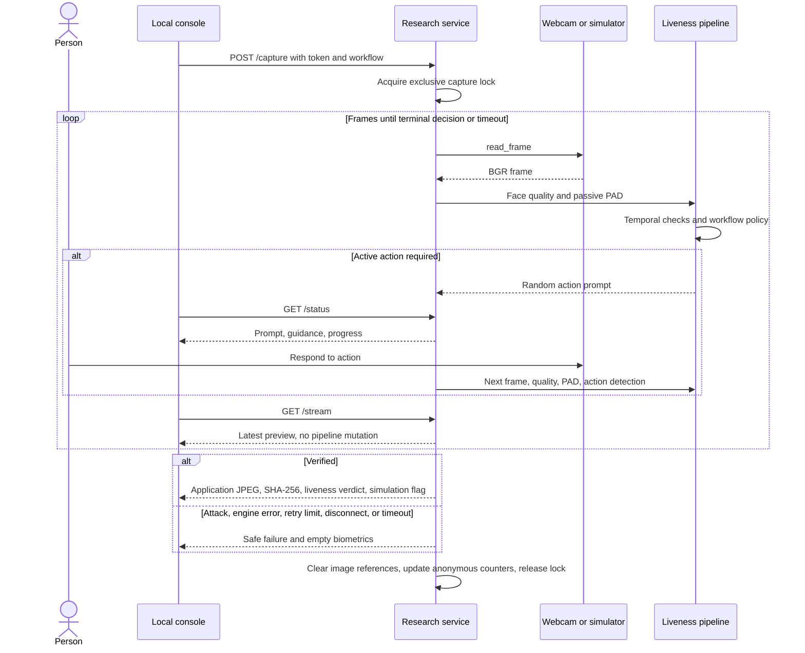
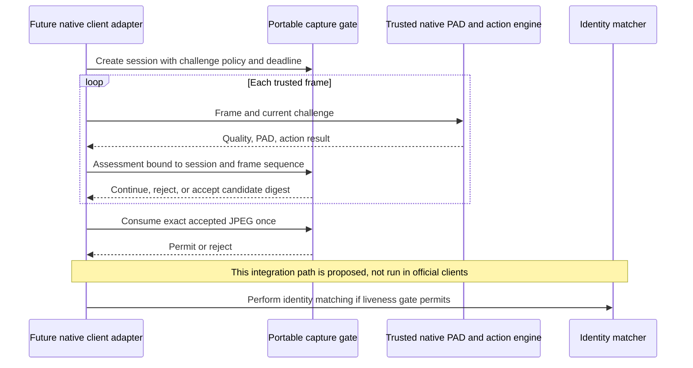

# Capture sequences

These diagrams describe the implemented prototype. The native client's identity matcher and final registration acceptance remain outside this repository's verified integration.

