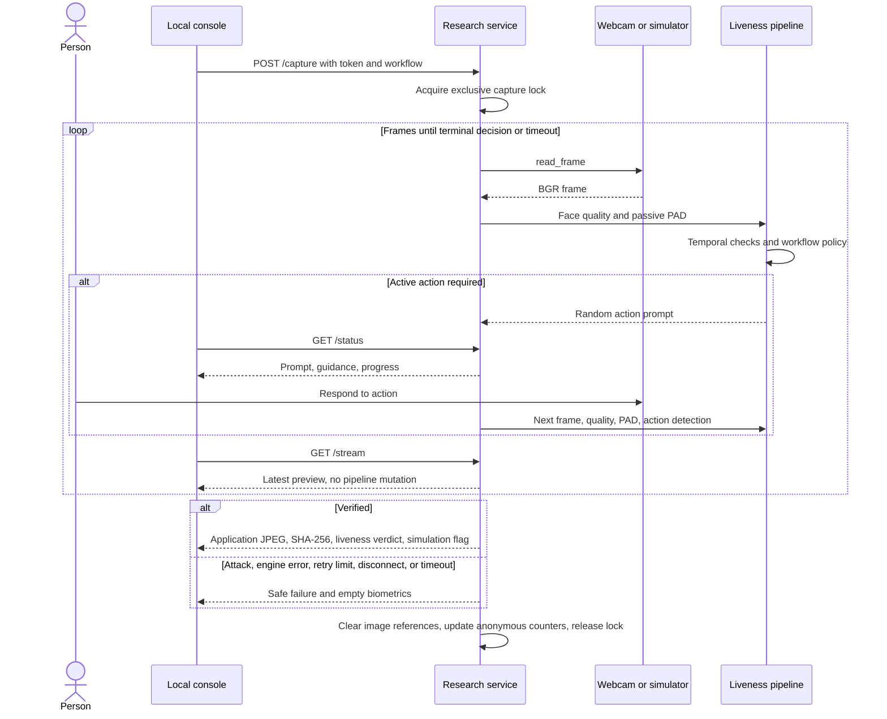

# Capture sequences

The first diagram describes the local Python prototype. The following diagrams describe the current patched native checkpoints and their limits. They show software acceptance paths; they do not claim successful live camera workflows or physical attack accuracy.



```mermaid
sequenceDiagram
    participant Desktop as Patched Desktop client
    participant Preview as Native preview session
    participant Engine as Native PAD and action engine
    participant Gate as Capture acceptance checkpoint
    participant Matcher as Existing identity matcher
    Desktop->>Preview: Start operator/supervisor verification
    loop Preview frames
        Preview->>Engine: Frame, current action, policy
        Engine-->>Preview: PAD verdict, action progress, guidance
    end
    Desktop->>Gate: Candidate JPEG and current session proof
    Gate->>Engine: Verify proof, role, expiry, exact JPEG digest
    alt Required evidence valid and PAD passes
        Gate-->>Desktop: Allow candidate once
        Desktop->>Matcher: Continue normal identity matching
    else Missing, expired, mismatched, or failed evidence
        Gate-->>Desktop: Reject before identity matching
    end
    Note over Desktop,Gate: Controlled controller tests use synthetic frames and injected action geometry; live camera success is unverified
```

```mermaid
sequenceDiagram
    participant RC as Patched Android Registration Client
    participant SBI as Camera-owning reference SBI
    participant Camera as Camera2 stream
    participant Engine as Native PAD and action engine
    participant Ledger as One-use transaction ledger
    RC->>SBI: Request capture with transaction and optional policy hints
    SBI->>Camera: Open camera and start bounded session
    loop Session frames
        Camera-->>SBI: JPEG frame
        SBI->>Engine: Frame, requested count/pool/retry policy, PAD checks
        Engine-->>SBI: Face/PAD/action result
    end
    alt Session and PAD pass
        SBI->>SBI: Build ISO from exact challenged JPEG
        SBI->>SBI: Sign capture payload with active result
        SBI-->>RC: Signed SBI response
        RC->>RC: Verify signature, trust, timestamp, transaction
        RC->>Ledger: Validate evidence and consume transaction once
        RC->>RC: Apply client PAD and store accepted capture
    else Failure or interruption
        SBI-->>RC: Empty failed capture
        RC->>RC: Keep capture out of storage
    end
    Note over RC,Ledger: Version 2 binds action types, session timing and retry use to the exact JPEG; client policy is checked after signed capture, caller policy mapping is pending, and emulator tests use fixture trust and simulated action metadata
```
