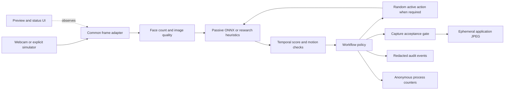
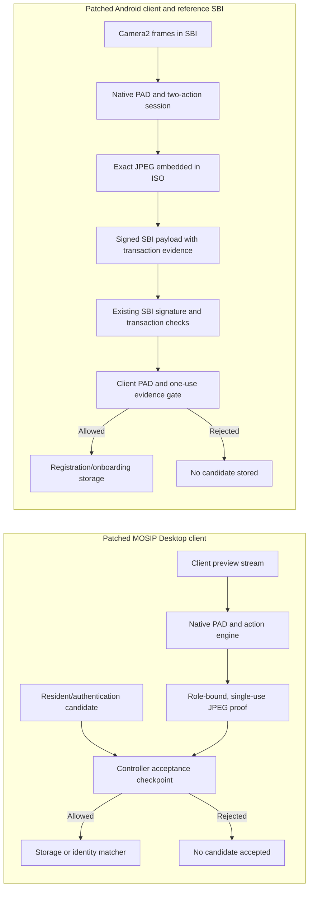

# Technical design

This document covers three related paths: the Python research prototype, the pinned MOSIP Desktop and Android client patches, and the camera-owning reference SBI extension. The Python HTTP service runs on a desktop host; it is not the Android deployment architecture. These implementations have build and synthetic/emulator evidence, but complete live client workflows, physical attack performance, and production device trust remain unverified. See the [requirement matrix](REQUIREMENTS_MATRIX.md) and [local delivery status](LOCAL_DELIVERY_STATUS.md) for the exact evidence boundary.

## Python prototype components and data flow

## Native client checkpoints

The Desktop checks and Android/SBI path are source integrations with retained build and controlled-test evidence for earlier source milestones. The Desktop diagram does not imply support for every capture format or screen. The Android SBI camera activity accepts validated action-count, blink/turn-pool, timeout and retry settings from request `customOpts` and includes the resulting session claims in version 2 signed evidence. The pinned registration-client patch now attaches its cached resident/operator policy to that request; the registration client checks signed claims against its own current policy. These latest source edits need fresh platform builds before they can be described as packaged Android evidence.

`VideoFrame` carries a BGR `uint8` array, dimensions, frame number, timestamp, and optional device metadata. The pipeline rejects invalid pixel layouts. It does not trust simulator metadata as evidence of a completed action. Device adapters implement connection, frame delivery, stream control, and capability discovery. The L1 adapter is simulated and does not supply secure hardware attestation.

## Decision flow

The pipeline detects faces and checks lighting, sharpness, size, and centering. A tracked face box cannot bypass the search for additional faces. Quality measurements are engineering heuristics; they do not produce an ISO face interchange record.

Passive evaluation returns `BONA_FIDE_LIVE`, `UNCERTAIN`, `PRESENTATION_ATTACK`, or `PROCESSING_ERROR`. Scores are model or heuristic outputs, not calibrated probabilities of human presence. The resident path accumulates 25 passive frames and evaluates a rolling window of 15. A high score also requires temporal stability and observed motion. Static or uncertain input escalates to active verification when enabled. Motion alone does not distinguish a live face from a moving photograph.

Operator and supervisor policies require active challenges by default. A random action is selected from the configured pool. The existing action detector tracks blink, smile, left/right turn, and up/down movement. An active frame still undergoes quality and PAD checks. A failed PAD result terminates acceptance. Face loss invalidates partial action history and consumes a retry. Terminal rejection cannot change to success without a reset.

The Python prototype stops at liveness verification and does not perform identity matching or construct registration packets. The native Desktop and Android patches connect liveness checks to client acceptance points, but complete live authentication/registration, packet generation and production SBI trust remain unverified.

## Concurrency and privacy

One capture owns the pipeline. A nonblocking capture lock rejects concurrent capture, device replacement, and policy mutation with HTTP 409. A device lock serializes preview reads and capture reads. During capture, preview clients receive the latest processed frame. Preview clients never call `process_frame`.

Frames and the accepted image exist in memory. The service clears its captured-image and preview references after completion or timeout. Python cannot guarantee cryptographic erasure of every memory copy, and clients receiving the JPEG control their own retention. HTTP responses disable caching. The audit logger recursively removes buffers and common sensitive keys. Session counters retain totals only and reset on restart.

The audit chain links canonical event JSON with SHA-256. A separate trusted checkpoint is needed to detect deletion or wholesale replacement. It is not a substitute for a protected logging backend.

## Offline operation and configuration

The installed runtime and local models require no network calls for inference, action generation, or policy decisions. Installation and fetching an updated model require network access. Resident, operator, and supervisor policies have independent thresholds, required action counts, timeouts, retries, and active-challenge requirements. The API applies validated updates atomically, updates the actual detector threshold, and resets the session. Policies are in memory; secure synchronized configuration distribution is not implemented.

Global `liveness_enabled: false` stops verified capture. It cannot produce a JPEG labelled `livenessVerified=true`. A production enable/disable workflow must integrate an explicit, audited client policy for any permitted unchecked capture.

## Secure model updates

The updater signs a canonical manifest containing model name, semantic version, payload checksum, and metadata. Receivers verify the payload and signed manifest, reject path traversal, and compare the new version with a persisted high-water mark. Ed25519 receivers need only a public key. HMAC mode requires a shared secret and is a separate trust model.

The updater writes a temporary payload and swaps it atomically. Its conservative version high-water mark is written before publishing the new model. A crash can require operator recovery, but must not silently permit replay of an older version. A manual rollback preserves the high-water mark. The model file and version record are not a transactional database; multi-process deployment and power-loss testing remain integration work. Installation does not automatically hot-swap a running inference session.

## Native client integration

The pinned Desktop patch adds in-process ONNX PAD and landmark processing at the resident capture and authentication acceptance points. Its operator/supervisor preview binds a one-use active proof to the exact JPEG candidate; unsupported formats or missing required evidence fail closed. The actual five-module Desktop reactor builds, and controller/preview checks exercise the patched upstream components with synthetic inputs and injected action geometry. This does not establish a successful live action or a complete camera-to-storage workflow.

The pinned Android Registration Client patch checks decoded SBI captures after the existing signature, certificate-trust, timestamp, and transaction validation, before resident or onboarding storage. The reference camera SBI owns its Camera2 stream, evaluates its own frames, and binds its active result to the exact ISO image and transaction. The client enforces one-use transaction evidence and performs its own PAD check. The latest retained API 34 camera-disabled instrumentation records 17 Registration Client tests and eight reference-SBI tests. Fixture keys, repositories, and action metadata are used in the signed-evidence tests; these results do not establish production PKI or human action accuracy.

`NativeCaptureGate` remains a portable Java 8 component for the standalone contract. It binds accepted bytes to a session and permits consumption once, but it trusts its caller's inference result. It does not make an untrusted client-supplied `PASSED` field trustworthy.

The Java HTTP adapter is still a separate transport example. It validates loopback URLs, restricts workflow names, requires a configured bearer token, limits response size, applies timeouts, and avoids printing biometric payloads. Native implementation details, pinned source revisions, and acceptance limits are documented in the [integration contract](NATIVE_INTEGRATION.md), [native integration report](../integrations/native/README.md), and [camera SBI design](CAMERA_SBI_INTEGRATION.md).

## Standards and evaluation

ISO/IEC 30107 is relevant to attack models and evaluation; this project does not claim certification. ISO/IEC 19794-5 defines a face image interchange format. A Base64 JPEG plus image-quality checks is not proof of that format's conformance. Real evaluation requires consented bona fide subjects, representative presentation attack instruments, device and lighting variation, fixed thresholds, separate development/test participants, and reported nonresponses. See the [evaluation protocol](EVALUATION_PROTOCOL.md).
